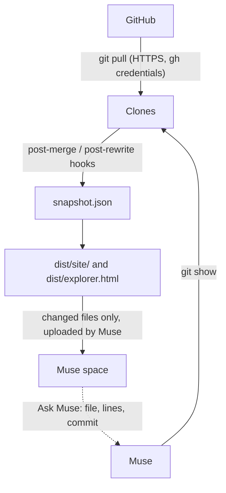

# Architecture

## Components

| Component | Location | Role |
| --- | --- | --- |
| Clones | `~/ghq/github.com/<owner>/<repo>` | Local copies of the selected repositories, managed by ghq |
| Tool | `~/workspace/muse-repo-viewer` (`~/workspace/muse-repo-explorer` for installs from before the rename) | This repository: the CLI, hook scripts, the viewer page and the agent instructions (`MUSE_SETUP.md`) |
| State | `~/workspace/repo-explorer` | Snapshot, built page files, Mermaid, sync state; outside any repository |
| Viewer space | Muse space | A private page that displays the built files |

## Data flow

1. `refresh` pulls every clone with `--ff-only`.
2. The snapshot is built from each repository's `HEAD` commit and written to `snapshot.json`.
3. The page files are built from the snapshot (see [Viewer page](page.md#delivery)): a small
   index, one compressed content file per repository, Mermaid, and the page itself.
4. The built files are compared with those recorded when the space was last updated. The result
   is either `UP_TO_DATE` or `PAGE_UPDATE_NEEDED` with the exact files to upload or delete.
5. After the space has been updated, `mark-synced` records the new state.

Pulls performed outside `refresh` trigger the same rebuild through git hooks, so the built files
are always current. Updating the space itself remains an explicit step.

## Design decisions

**Local clones instead of a connector.** A connector returns whole files into the agent's
context. With local clones, the agent can search first and read only the relevant lines.
Issues and pull requests continue to be accessed through the connector.

**HTTPS with the gh device flow.** Outbound SSH is often unavailable in the Muse environment.
The device flow lets the user approve access in a browser, so no password or token appears in
the conversation; `gh auth setup-git` then provides credentials to git.

**A snapshot instead of a live server.** The Muse environment does not accept inbound
connections, so a server running there cannot be reached from a phone. The code is therefore
delivered to the page as static files.

**Reading from `HEAD`.** The snapshot is built with `git ls-tree` and `git cat-file` rather
than from the working tree. Uncommitted changes and the targets of symbolic links are never
included, and the displayed content always corresponds to the displayed commit.

**A bundled page.** The page is part of this repository rather than generated by the agent.
This removes the largest variable cost from setup and makes the result identical for every user.

**Initial language from the Muse user.** The setup request is written in English, so Muse is told
to choose the page's initial language from the language the user normally uses with it, not from
the request. `setup --lang` records it in the page. Viewers can change the language in the page's
settings; without an initial language the page follows the browser.

**Loading on demand.** Opening the space reads only the index (repository list and file tree).
The content of a repository is read when the repository is first shown, and is prefetched in
the background as soon as it is selected, so opening a file is immediate. All data is
gzip-compressed and decompressed by the browser. The start-up cost therefore does not grow with
the amount of code in other repositories.

**Mermaid verified, not vendored.** Mermaid is too large for this repository. `setup` downloads
a pinned version and keeps it only if its SHA-256 matches the value in the CLI. It is loaded by
the page only when a diagram is displayed.

**A one-line setup.** The user sends a single line that points Muse to `MUSE_SETUP.md`. Those
instructions only tell Muse to run `next` repeatedly. `next` inspects the current state
(installation, sign-in, repositories, the space) and prints the one action required, so the setup
logic is in tested code rather than in a long prompt, and the same instructions serve both the
first setup and later refreshes.

**Questions by reference.** When the user asks Muse about code from the viewer, the message
names the repository, commit, file and line range and gives the command to read them from the
local clone. Muse reads only those lines, and the code does not have to pass through the
conversation.

**Change detection in scripts.** Whether the space needs updating, and which files, is decided by
the CLI, not by the agent. In a period without new commits, a refresh costs one command and one
line of output.

## Token efficiency

| Task | Approach |
| --- | --- |
| Reading source code | Local search and partial reads instead of whole files via a connector |
| Creating the page | Uploading bundled files instead of generating a page |
| Handling large files | Uploading by file path; the prompt forbids reading them into context |
| Running the setup | A one-line request; `next` prints one action at a time; every command is idempotent |
| Interpreting results | Output limited to a few lines; per-repository lines appear only on failure |
| Deciding whether to update | Determined by `refresh` |
| Updating the space | Only the index and the files of changed repositories are uploaded |
| Asking about code | The viewer sends a reference and a read command, not the code |
| Rebuilding after a pull | Performed by git hooks without involving the agent |
